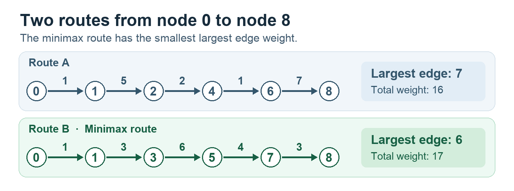

# Minimax Path Visualization

Find and visualize a path whose largest edge weight is as small as possible.
The Python demo uses a Dijkstra-style search on a directed graph and saves
each step as a PNG using NetworkX and Matplotlib.



[Open a snapshot generated by the program](img/graph15.png).

## Example

The demo graph has two routes from node `0` to node `8`.

| Route | Largest edge weight | Sum of edge weights |
| --- | ---: | ---: |
| `0 → 1 → 2 → 4 → 6 → 8` | 7 | 16 |
| `0 → 1 → 3 → 5 → 7 → 8` | **6** | 17 |

The demo selects the second route because its heaviest edge has weight **6**.
When considering an edge, the search takes the maximum of the current path
score and that edge's weight. It keeps a lower score when it finds one.

## Run the demo

From the repository root, install the dependencies and run the script.

```bash
python -m pip install networkx matplotlib
python main.py
```

The script saves numbered snapshots to [`img/`](img/). Running it again replaces
snapshots with the same filenames. To try another graph, edit
`edges_with_weights`, `start_node_values`, and the calls to `find_best_way` in
[`main.py`](main.py).

## Reading a snapshot

- **Nodes:** green is the current node, red is visited, yellow is a candidate,
  and cyan is unvisited. Each label lists the node ID, best score so far, and
  predecessor. A score of `1000000` and predecessor `-1` are the initial values.
- **Edges:** the number is its weight. Red marks a chosen predecessor edge;
  black marks other edges.
